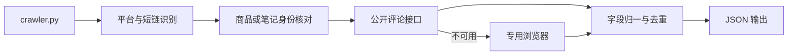

<p align="center">
  
</p>

<p align="center">
  <strong>ReviewAgent Crawler</strong><br>
  独立运行的跨平台评论采集工具：输入商品或笔记链接，输出结构化 JSON。
</p>

# ReviewAgent Crawler (`v2`)

## 项目介绍

`v2` 是 ReviewAgent 的独立爬虫工具分支，专门负责电商与内容平台评论的链接识别、真实采集、字段归一和 JSON 输出。

主要能力：

- 支持淘宝 / 天猫、京东和小红书商品或笔记链接。
- 识别 `e.tb.cn`、`3.cn`、`xhslink.com`、`xhslink.cn` 等分享短链。
- 优先尝试平台公开接口，必要时使用 ReviewAgent 专用浏览器。
- 支持 Chrome、Edge、Firefox 和自动浏览器选择。
- 用户首次登录后，在指定的本机运行目录中复用专用浏览器状态。
- 支持评论分页、滚动、折叠评价、字段归一、评论 ID 去重和正文占位过滤。
- 输出平台、采集时间、评论数量、采集事实、错误代码和评论数组。
- 遇到登录、验证码、频控页、精简页或页面降级时返回明确状态，不生成评论凑数。

完整的评论分析与运营工作台位于 [`main` 分支](https://github.com/RoderickWilliams/review-analysis-agent/tree/main)。

## 项目架构



核心文件：

```text
crawler.py                         命令行入口
src/reviewagent/
  object_resolver.py              平台、短链和商品身份解析
  browser_collection.py           平台采集统一入口
  browser_session.py              专用浏览器与可信交互
  public_collection.py            公开接口采集
  review_data.py                  字段归一、去重和证据字段
  scrapers/
    taobao_*.py                   淘宝 / 天猫适配
    jd_*.py                       京东适配
    xhs_reader.py                 小红书只读采集后端
docs/crawler.md                   参数、输出与退出码说明
tests/                             链接解析与采集契约测试
```

### 采集策略

- **淘宝 / 天猫**：解析稳定商品 ID，进入完整详情与评价链路，区分主评价、折叠评价和只有星级的占位记录。
- **京东**：核对商品 ID，并通过“只看本商品”或等效 SKU 信息确认评论归属。
- **小红书**：按笔记读取社交评论，并保留其社交来源属性。
- **通用规则**：采集上限不是必须采满的配额；页面实际只有少量评论时按实际数量结束。

### 输出结构

```json
{
  "url": "https://detail.tmall.com/item.htm?id=568742960823",
  "platform": "tmall",
  "collected_at": "2026-10-28T17:54:58+08:00",
  "status": "ok",
  "count": 14,
  "facts": {
    "displayed": 33,
    "folded": 22,
    "rating_only": 19,
    "selected": 14
  },
  "reviews": [
    {
      "review_text": "……",
      "review_date": "2026-10-08",
      "reviewer_name": "匿名买家",
      "rating": 5,
      "sku": "……",
      "comment_id": "……",
      "platform": "tmall"
    }
  ]
}
```

失败或暂停时，`status` 为 `paused` 或 `failed`，并提供 `code`、`error` 和空的 `reviews` 数组，方便下游程序区分“没有评论”和“本次没有成功读取评论”。

## 部署实现

### 环境要求

- Python 3.10+
- Chrome、Edge 或 Firefox
- Windows 10/11（当前主要支持环境）

### 安装

```cmd
git clone --branch v2 --single-branch https://github.com/RoderickWilliams/review-analysis-agent.git reviewagent-crawler
cd reviewagent-crawler
python -m venv .venv
.venv\Scripts\python.exe -m pip install --upgrade pip
.venv\Scripts\python.exe -m pip install -e ".[scrape]"
```

需要启用 Scrapling 后端时：

```cmd
.venv\Scripts\python.exe -m pip install -e ".[scrape,scrapling]"
```

### 基本用法

```cmd
.venv\Scripts\python.exe crawler.py ^
  --url "https://detail.tmall.com/item.htm?id=568742960823" ^
  --limit 300 ^
  --out output\reviews.json
```

京东示例：

```cmd
.venv\Scripts\python.exe crawler.py ^
  --url "https://item.jd.com/100394190476.html" ^
  --platform jd ^
  --out output\jd-reviews.json
```

小红书示例：

```cmd
.venv\Scripts\python.exe crawler.py ^
  --url "https://xhslink.cn/o/example" ^
  --platform xhs ^
  --out output\xhs-comments.json
```

### 参数

| 参数 | 默认值 | 说明 |
| --- | --- | --- |
| `--url` | 必填 | 商品或笔记的 HTTPS 链接 |
| `--platform` | `auto` | `jd`、`taobao`、`tmall`、`xhs` 或自动判断 |
| `--limit` | `300` | 单链接最多读取的记录数 |
| `--out` | `reviews.json` | 输出 JSON 路径 |
| `--home` | `runtime/` | 专用浏览器配置、缓存和运行数据目录 |
| `--browser` | `chrome` | `chrome`、`edge`、`firefox` 或 `auto` |
| `--quiet` | 关闭 | 不打印采集过程状态 |

当前 `--url` 接受纯 HTTPS 链接。完整平台分享文案需要先提取其中的 URL，再传给 CLI。

### 退出码

| 退出码 | 含义 |
| --- | --- |
| `0` | 采集流程完成；实际数量可能低于 `--limit` |
| `1` | 参数或本地环境错误 |
| `2` | 平台暂停或采集失败，例如登录、频控、精简页或导航失败 |

### 登录与运行目录

首次需要登录时，工具使用 `--home` 下的专用浏览器配置。用户自行扫码、输入验证码或完成身份校验，登录状态保存在本机并在后续任务中复用。

```text
runtime/
  browser-profiles/      专用浏览器登录状态
  cache/                 平台与驱动缓存
  output/                可选的采集产物目录
```

工具默认使用直连网络，不修改系统代理。任务结束时只关闭自己打开的专用窗口，不关闭用户原有浏览器窗口。

### 作为上游数据源

`crawler.py` 的 JSON 输出可以直接交给 pandas、Notebook、自有 API 或模型流程：

```python
import json
from pathlib import Path

payload = json.loads(Path("output/reviews.json").read_text(encoding="utf-8"))

if payload["status"] == "ok":
    reviews = payload["reviews"]
else:
    raise RuntimeError(payload.get("error", "采集未完成"))
```

请只采集你有权访问的数据，并遵守目标平台条款、适用法律和内部数据政策。工具不会破解验证码、绕过访问控制或通过账号轮换规避平台限制。

本项目使用 [MIT License](LICENSE)。
