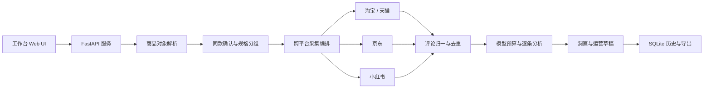

<p align="center">
  
</p>

<p align="center">
  <strong>面向电商运营的本地优先评论研究工作台</strong><br>
  从跨平台评论采集、商品分组和证据化分析，到可编辑的运营行动方案。
</p>

<p align="center">
  
  
  
</p>

<p align="center"><a href="https://roderickwilliams.github.io/review-analysis-agent/"><strong>▶ 在线演示（含完整工作台）</strong></a></p>

# ReviewAgent

## 项目介绍

ReviewAgent 是一个为电商运营人员设计的本地评论研究工具。用户可以输入商品名称、平台分享文案、商品链接或本地评论文件，完成商品识别、同款确认、评论采集、数据清洗、模型分析、用户洞察和运营内容整理。

主要能力包括：

- **跨平台输入**：支持淘宝 / 天猫、京东、小红书链接，以及 CSV、XLSX、JSON、TXT 和直接粘贴。
- **商品识别与分组**：同品牌、同型号、同关键规格才合并；不同规格和竞品分别分析并列比较。
- **真实评论采集**：公开接口与专用浏览器协同，按平台做多级降级（接口 → 浏览器 → DOM 回退），支持短链解析、人工登录、分页、滚动、去重和字段归一；采不到时在结果里写缺口原因。
- **证据化分析**：识别情绪、反讽表达和内容疑点，提炼附带评论原句的用户痛点与改进方向；每条结论逐字回查原句，对不上的提议单独列出、不计入结论。
- **运营行动**：按需生成商品卖点、客服话术和小红书种草选题草稿；卖点只取正向评论原句，缺陷说明不冒充卖点，草稿可继续编辑。
- **本地工作台**：提供评论库、用户洞察、行动计划、历史恢复和多格式导出；另有独立的展示页。
- **可信度与刷评信号**：时间突发、近重复、评分异常、长度均匀度、跨评论重复短语五项信号汇总为评论可信度；分数是启发式，不认证单条评论真假。
- **成本控制**：根据模型价格与预算控制 token 使用量，保留已完成结果和模型实际覆盖范围；单份研究有人民币预算上限。
- **本地优先**：API Key 仅保存在服务进程内存中；评论、报告和专用浏览器状态默认保存在本机。
- **多入口**：CLI、HTTP API 和本地 Web 工作台已跑通；仓库同时附带 DSH 插件与 Agent Skill 的接入代码。

仓库分支：

- `main`：完整 ReviewAgent 工作台、分析链路、运营输出、展示页和部署配置。
- `v2`：可独立运行的评论采集工具，不包含工作台与模型分析流程。

## 项目架构

ReviewAgent 采用单机、本地服务架构。浏览器工作台通过 FastAPI 调用统一业务层；采集、分析、洞察、导出和历史管理使用同一套对象与数据模型。



### 核心模块

```text
src/reviewagent/
  http_api.py            FastAPI 接口、本地设置与静态工作台
  analysis_tasks.py      后台任务、取消、阶段状态与恢复
  object_resolver.py     商品链接、分享文案、短链与平台识别
  same_product.py        同款候选与匹配规则
  product_groups.py      品牌、型号和关键规格分组
  collection.py          多来源采集汇总、选择与缺口管理
  browser_collection.py  专用浏览器采集编排
  browser_session.py     Chrome / Edge 会话和可信交互
  public_collection.py   平台公开接口采集
  review_data.py         评论字段归一、去重和证据编号
  model_settings.py      API Key 识别与模型配置
  model_budget.py        人民币预算与 token 停止线
  sentiment_agent_core.py 情绪、反讽和内容疑点分析
  trust_report.py        评论可信度信号与风险分级
  review_corpus.py       正负样本语料库（真实好评 / 疑似刷评）
  insights/              痛点、改进方向、选题与内容工具
  operations.py          行动计划与运营草稿
  store.py               SQLite 持久化、历史与恢复
  webui/                 默认工作台前端

showcase/                HR／作品集展示页
plugins/dsh-review-agent DeepSeek Harness 插件桥接
skills/                  项目配套技能
deploy/                  Docker 与 Windows 部署配置
tests/                   单元、接口与离线回归测试
```

### 数据流

1. 输入内容先被解析为统一商品对象，并提取平台、商品 ID、标题和规格信息。
2. 用户确认需要分析的商品与平台来源，未确认候选不会自动进入采集队列。
3. 采集层按平台顺序获取真实评论，保留来源信息、日期、评分、规格和失败原因。
4. 数据层完成字段归一、去重、时间窗处理和商品组归属。
5. 模型层根据预算选择样本并逐条分析，结果与原文证据编号绑定。
6. 洞察层生成用户痛点、改进方向和按需运营草稿；统计引擎同时输出评论可信度与刷评信号。
7. SQLite 保存分析对象、评论、进度、结果和人工编辑内容，导出层生成 CSV、JSON 与离线 HTML。

### 安全与数据边界

- 模型 API Key 只保存在当前服务内存中，服务重启后需要重新配置。
- 评论文本仅在用户主动开始模型分析或生成运营内容时发送给模型供应商。
- 平台登录使用 ReviewAgent 专用浏览器配置，不读取用户日常浏览器 Cookie。
- 验证码、扫码和身份校验由用户手动完成，程序不绕过平台访问控制。
- 运行数据默认保存在 `runtime/`，不会提交到 Git 仓库。
- 小红书只读采集拿到的评论量受平台限制，日期可能缺失；淘宝/京东的登录态和风控会变化，采不到时以缺口形式返回，不补造数据。

## 部署实现

### 环境要求

- Python 3.10+
- Windows 10/11（当前主要支持环境）
- Chrome 或 Edge
- 可选：DeepSeek 或 OpenAI 兼容模型 API Key

### 本地部署

```cmd
git clone --branch main https://github.com/RoderickWilliams/review-analysis-agent.git
cd review-analysis-agent
python -m venv .venv
.venv\Scripts\python.exe -m pip install --upgrade pip
.venv\Scripts\python.exe -m pip install -e ".[api,scrape,import]"
```

启动本地服务：

```cmd
.venv\Scripts\python.exe run_local.py --port 64628
```

打开工作台：

```text
http://127.0.0.1:64628/app/
```

API 文档：

```text
http://127.0.0.1:64628/docs
```

展示页：

```text
http://127.0.0.1:64628/showcase/
```

`run_local.py` 会：

- 将数据库、输出、缓存和浏览器配置固定到项目的 `runtime/`；
- 启用本地平台采集；
- 清空从外部环境变量继承的模型 Key，要求用户在工作台内配置；
- 使用本机浏览器与直连网络运行采集流程。

### Windows 快速启动

完成依赖安装后，也可以运行仓库根目录中的：

```text
启动ReviewAgent.bat
```

项目同时包含 PyInstaller 与 Inno Setup 配置，可用于制作 Windows 可执行程序和安装包：

```text
review_agent.spec
reviewagent_installer.iss
```

仓库只提供构建配置，不包含已编译的 exe 或安装包；需要桌面版时按上述文件自行构建。

### Docker 部署

仓库的 `deploy/` 目录提供 Dockerfile 与 Compose 配置：

```cmd
cd deploy
docker compose up --build
```

容器部署适合文件导入、API 和模型分析。需要本机可视浏览器、扫码登录和平台交互的采集流程，建议使用 Windows 本地部署。

### 模型配置

服务启动后，在工作台设置中粘贴 API Key。系统会识别供应商、接口地址和模型信息；确认后，该模型将用于评论分析与按需运营内容生成。支持配置多个 Key 轮换使用，单份研究受人民币预算上限约束。

未配置模型时，评论导入和平台采集仍可使用，模型分析功能会保持关闭。

### 运行目录

```text
runtime/
  data/reviewagent.db    分析记录、评论、结果和草稿
  output/                导出报告与采集产物
  cache/                 本地缓存
  browser-profiles/      ReviewAgent 专用浏览器登录状态
```

### 开发部署

安装开发依赖：

```cmd
.venv\Scripts\python.exe -m pip install -e ".[api,scrape,import,dev]"
```

运行离线测试：

```cmd
set PYTHONPATH=src
.venv\Scripts\python.exe -m pytest -q
```

本项目使用 [MIT License](LICENSE)。
